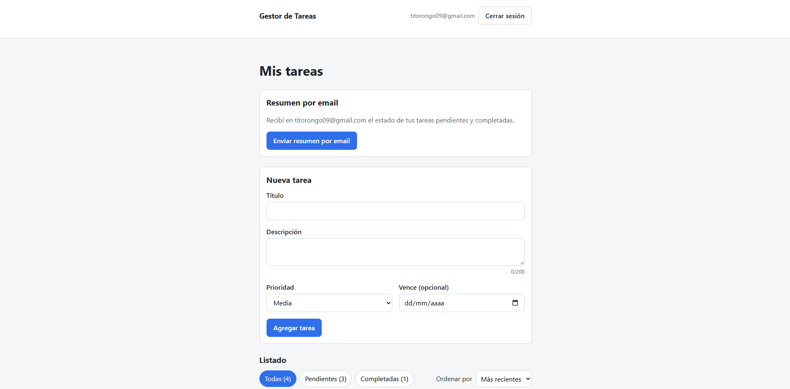
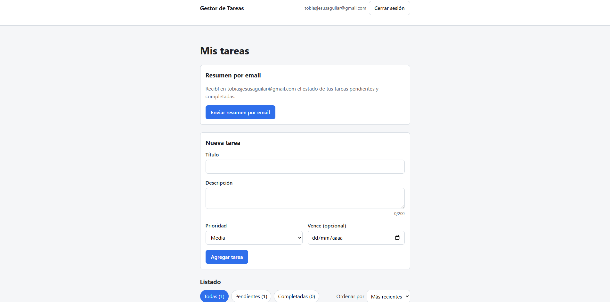
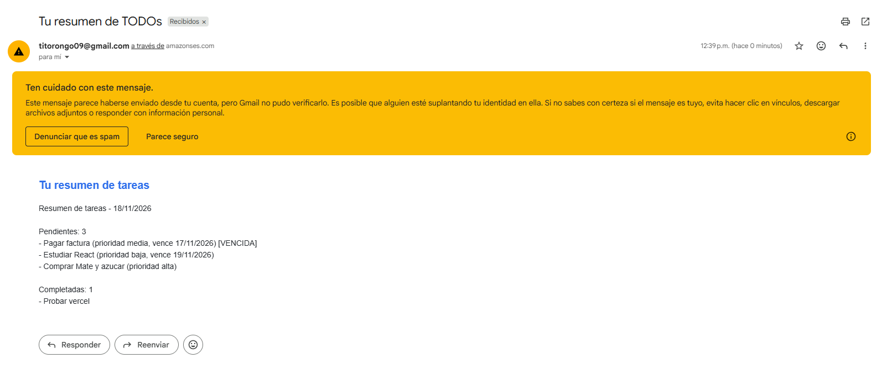

# Gestor de Tareas — Proyecto Integrador M4

SPA para que los empleados de un cliente de **MateCode** gestionen sus tareas diarias: cada usuario se registra, inicia sesión y administra **sus propias** tareas, que se guardan en la nube y se sincronizan en tiempo real. Desde la app puede enviarse por email un resumen del estado de sus tareas.

- **Producción:** https://pi-m4-tareas.vercel.app
- **Repositorio:** https://github.com/tobiasjesus/pi-m4-tareas
- **Autor:** Tobías Aguilar — Henry, Full Stack (Módulo 4)

---

## Índice

1. [Funcionalidades](#funcionalidades)
2. [Stack](#stack)
3. [Arquitectura y decisiones](#arquitectura-y-decisiones)
4. [Modelo de datos y seguridad (Firestore)](#modelo-de-datos-y-seguridad-firestore)
5. [Email feature (SES)](#email-feature-ses)
6. [Instalación y ejecución local](#instalación-y-ejecución-local)
7. [Variables de entorno](#variables-de-entorno)
8. [Testing](#testing)
9. [Deploy](#deploy)
10. [Uso de IA en el proyecto](#uso-de-ia-en-el-proyecto)
11. [Limitaciones conocidas](#limitaciones-conocidas)

---

## Funcionalidades

**Autenticación**
- Registro e inicio de sesión con **email/contraseña** y con **Google**.
- Sesión persistente (se mantiene al recargar) y cierre de sesión.
- Rutas protegidas: sin sesión no se puede ver `/dashboard`; tras el login se vuelve a la ruta que se intentó abrir.
- Validación de formularios antes de enviar y errores de Firebase traducidos a mensajes claros (sin códigos internos).

**Tareas (por usuario)**
- Crear (título + descripción), listar, editar, eliminar (con confirmación) y marcar como completada.
- Cada usuario ve **solo sus tareas** (filtro por `userId` + reglas de seguridad).
- Sincronización en **tiempo real** con `onSnapshot`: la UI se actualiza sola después de cada operación.
- Estados de carga, lista vacía y error visibles.

**Email**
- Botón **"Enviar resumen por email"**: envía al email del usuario el resumen de tareas pendientes y completadas usando **AWS SES** a través de una **Vercel Function**. Estados loading / éxito / error.

**Extra credits implementados**
- ✅ Filtros: todas / pendientes / completadas (con contadores).
- ✅ Fecha de vencimiento (opcional) con indicador de tarea **vencida**.
- ✅ Prioridad (alta / media / baja) y **orden** por prioridad, por vencimiento o por más recientes.
- ✅ Bonus SES: cuerpo del email en **HTML** además de texto, y **cooldown de 60 s** entre envíos.
- ⏳ Drag & drop (dnd-kit): el modelo ya incluye el campo `order` y el servicio `reorderTasks` (escritura atómica con `writeBatch`), pero la interfaz de arrastre **no está implementada**.

**Diseño:** mobile-first (Flexbox + media queries), botones e inputs de 44 px de alto para uso táctil, foco visible y atributos de accesibilidad en formularios (`label htmlFor`, `aria-invalid`, `aria-describedby`, `role="alert"`).

---

## Stack

| Capa | Tecnología |
|---|---|
| Frontend | React 19 + TypeScript (modo estricto) + Vite |
| Ruteo | React Router |
| Auth y base de datos | Firebase Authentication + Cloud Firestore (BaaS) |
| Email | AWS SES (SDK v3) invocado desde una Vercel Function |
| Testing | Vitest + React Testing Library + jsdom |
| Calidad | ESLint (reglas de React Hooks) |
| Deploy | Vercel |

> El material del curso menciona React 18; Vite instala actualmente React 19. Todas las APIs usadas (`useState`, `useEffect`, Context, etc.) funcionan igual en ambas versiones.

---

## Arquitectura y decisiones

```
├─ api/
│  └─ send-email.ts          # Vercel Function (BFF) → AWS SES
├─ src/
│  ├─ pages/                 # LoginPage, RegisterPage, DashboardPage, NotFoundPage
│  ├─ components/
│  │  ├─ ui/                 # FormField, Button (reutilizables)
│  │  ├─ auth/               # AuthForm (compartido por login y registro)
│  │  ├─ layout/             # Header
│  │  └─ tasks/              # TodoForm, TodoList, TodoItem, TaskToolbar, EmailSummaryButton
│  ├─ features/auth/         # authContext + AuthProvider (sesión centralizada)
│  ├─ hooks/                 # useAuth, useTasks
│  ├─ services/              # firebase.ts, taskService.ts, email.ts
│  ├─ routes/                # AppRouter, ProtectedRoute, PublicOnlyRoute
│  ├─ types/                 # Task, TaskFormValues, AuthContextValue…
│  ├─ utils/                 # validaciones, errores de auth, filtros/orden, buildSummary
│  └─ __tests__/             # tests unitarios, de componentes y del hook
├─ tests/api/                # tests de la Vercel Function
├─ docs/evidencias/          # capturas de las pruebas
├─ firestore.rules           # reglas de seguridad publicadas en Firebase
├─ vercel.json               # rewrite para que las rutas de la SPA funcionen al recargar
└─ .env.example              # nombres de las variables (sin valores)
```

**Decisiones principales**

- **Separación por capas.** Los componentes solo muestran datos y disparan acciones; el acceso a Firebase vive en `services/`, la suscripción en tiempo real en `hooks/useTasks` y la lógica pura (validaciones, filtros, orden, resumen) en `utils/`, lo que la hace fácil de testear.
- **Una sola inicialización de Firebase** (`services/firebase.ts`) que exporta `auth` y `db`.
- **Sesión centralizada (patrón Context + hook).** `AuthProvider` es la única fuente de verdad: escucha `onAuthStateChanged` (patrón Observer) y cancela la suscripción al desmontar. `useAuth()` lanza un error si se usa fuera del Provider.
- **`ProtectedRoute` con estado `loading`.** Mientras Firebase confirma la sesión no se redirige, así se evita el "parpadeo" al login al recargar. Usa `Navigate replace` + `state.from`.
- **`PublicOnlyRoute`** (decisión propia): un usuario logueado que entra a `/login` es redirigido a sus tareas.
- **Tiempo real con `onSnapshot`** en lugar de `getDocs` + recarga manual: después de crear/editar/borrar no se toca el estado local, Firestore envía la lista actualizada.
- **Tipado sin `any`.** Las variables de entorno están tipadas (`vite-env.d.ts`), los errores se manejan como `unknown` con narrowing (`instanceof FirebaseError` / `instanceof Error`).
- **Componentes reutilizables:** `AuthForm` sirve para login y registro (prop `mode`); `TodoForm` sirve para crear y editar.
- **Filtros y orden en el cliente** con funciones puras (`utils/taskList.ts`), aplicadas con `useMemo`.
- **Estilos:** CSS plano con variables (`:root`), sin librerías extra.

---

## Modelo de datos y seguridad (Firestore)

Colección `tasks`; el id lo genera Firestore (`doc.id`, no se guarda como campo).

```ts
interface Task {
  id: string
  title: string
  description: string
  completed: boolean
  userId: string                  // uid del dueño
  createdAt: Timestamp | null     // serverTimestamp(); null un instante mientras la escritura está pendiente
  priority: 'low' | 'medium' | 'high'
  dueDate: string | null          // 'YYYY-MM-DD'
  order: number                   // reservado para el orden manual (drag & drop)
}
```

**Consulta:** `where('userId', '==', uid)` + `orderBy('createdAt', 'desc')`, que requiere un **índice compuesto** (`userId` ascendente, `createdAt` descendente), creado en la consola de Firebase.

**Reglas de seguridad** ([`firestore.rules`](./firestore.rules)): denegar todo por defecto; en `tasks`, solo el dueño puede leer, actualizar y borrar (`resource.data.userId`), solo se puede crear con el propio `uid` (`request.resource.data.userId`), no se puede cambiar el dueño y se valida la forma del documento (tipos, campos permitidos, largo de título y descripción, prioridad válida). El `where` del frontend **no protege**: es lo que permite que la consulta cumpla la regla; sin él Firestore responde `permission-denied`.

**Evidencia — usuario A no ve las tareas de usuario B (probado en producción):**

| Usuario A (4 tareas) | Usuario B (solo su tarea) |
|---|---|
|  |  |
|  |  |

---

## Email feature (SES)

### Flujo (patrón BFF)

```
React ── POST /api/send-email { to, summary } ──▶ Vercel Function ──▶ AWS SES ──▶ bandeja del usuario
(sin credenciales)                                (process.env con las claves)
```

1. El usuario hace clic en **"Enviar resumen por email"**.
2. `buildSummary(tasks)` arma el texto plano: fecha, "Pendientes: N" con títulos (prioridad, vencimiento, `[VENCIDA]`) y "Completadas: N".
3. `services/email.ts` hace `fetch('/api/send-email')` con `{ to: user.email, summary }`.
4. `api/send-email.ts` valida el payload, arma el email (texto + HTML) y lo envía con `SendEmailCommand`.
5. El botón muestra *Enviando…* → éxito (y cooldown de 60 s) o el mensaje de error real del backend.

**¿Por qué no llamar a SES desde el navegador?** Todo lo que llega al bundle del frontend (incluidas las variables `VITE_*`) puede inspeccionarse; las claves de AWS quedarían expuestas y cualquiera podría usarlas. La Vercel Function actúa como intermediario (*Backend for Frontend*): es la única que conoce las credenciales.

### Contrato del endpoint

| | |
|---|---|
| Método | `POST` (otro método → `405`) |
| Body | `{ "to": "email@dominio.com", "summary": "texto" }` |
| `200` | `{ "ok": true, "messageId": "..." }` |
| `400` | payload faltante o inválido (email con formato incorrecto, `summary` vacío o de más de 10 000 caracteres) |
| `500` | `ServerMisconfigured` (falta `SES_FROM_EMAIL`/`AWS_REGION`) o error de SES (`MessageRejected`, etc.) |

- El **remitente** lo define el servidor (`SES_FROM_EMAIL`), nunca el cliente.
- Todos los caminos responden (evita `504 FUNCTION_INVOCATION_TIMEOUT`).
- Los errores se registran con nombre y mensaje, nunca con credenciales.
- El texto del usuario se escapa antes de insertarlo en el HTML del email.

### Configuración de AWS usada

- Región: **`us-east-2` (Ohio)**. La cuenta (plan gratuito) solo permite esa región; las identidades de SES son regionales, por eso `AWS_REGION` debe coincidir.
- SES en **sandbox**: el email remitente/destinatario está verificado en *Verified identities*.
- Usuario IAM dedicado `ses-sender` con access key programática (sin acceso a consola).

### Evidencia

Email recibido desde la app en producción:




Prueba del handler en local con las credenciales reales (respuestas obtenidas):

```
[GET]                  405 {"ok":false,"error":"MethodNotAllowed","message":"Use POST"}
[sin body]             400 {"ok":false,"error":"BadRequest","message":"Missing 'to' or 'summary'"}
[falta summary]        400 {"ok":false,"error":"BadRequest","message":"Missing 'to' or 'summary'"}
[email inválido]       400 {"ok":false,"error":"BadRequest","message":"Invalid 'to' email address"}
[envío real]           200 {"ok":true,"messageId":"010f01a1ef2a1d0a-..."}
```

---

## Instalación y ejecución local

Requisitos: Node.js 20+ y npm.

```bash
git clone https://github.com/tobiasjesus/pi-m4-tareas.git
cd pi-m4-tareas
npm install
cp .env.example .env      # completar los valores (ver tabla siguiente)
npm run dev               # http://localhost:5173
```

| Script | Qué hace |
|---|---|
| `npm run dev` | Servidor de desarrollo de Vite (frontend) |
| `npm run build` | Chequeo de tipos (`tsc -b`) + build de producción |
| `npm run lint` | ESLint |
| `npm run test` | Ejecuta todos los tests una vez |
| `npm run test:watch` | Tests en modo observador |

**Firebase:** crear un proyecto con una app web, habilitar *Email/Password* y *Google* en Authentication, crear Firestore en **modo producción**, publicar [`firestore.rules`](./firestore.rules) y crear el índice compuesto (`tasks`: `userId` ↑, `createdAt` ↓; si falta, la consola del navegador muestra en desarrollo el link para crearlo).

**Endpoint de email en local:** `npm run dev` sirve solo el frontend, por lo que `/api/send-email` no está disponible ahí. La Function puede ejecutarse localmente con la Vercel CLI (`vercel dev`, requiere vincular el proyecto con `vercel link`). En este proyecto el handler se validó con los tests automatizados, con una ejecución local directa (ver evidencia) y en producción.

---

## Variables de entorno

Archivo `.env` en la raíz (**no se sube**: está en `.gitignore`). [`.env.example`](./.env.example) tiene los nombres sin valores.

| Variable | Dónde se usa | Descripción |
|---|---|---|
| `VITE_FIREBASE_API_KEY` | Frontend | Config de la app web de Firebase |
| `VITE_FIREBASE_AUTH_DOMAIN` | Frontend | Config de la app web de Firebase |
| `VITE_FIREBASE_PROJECT_ID` | Frontend | Config de la app web de Firebase |
| `VITE_FIREBASE_APP_ID` | Frontend | Config de la app web de Firebase |
| `AWS_REGION` | Function | Región de SES (`us-east-2`) |
| `AWS_ACCESS_KEY_ID` | Function | Access key del usuario IAM |
| `AWS_SECRET_ACCESS_KEY` | Function | Secret key del usuario IAM |
| `SES_FROM_EMAIL` | Function | Remitente verificado en SES |

- Solo las variables con prefijo **`VITE_`** llegan al navegador. La configuración de Firebase es pública por diseño (la protección la dan las reglas), pero igual no está escrita en el código.
- Las de AWS **no llevan `VITE_`**: solo las lee la Function con `process.env`.
- En Vercel se cargan en *Settings → Environment Variables*; cualquier cambio requiere un **redeploy**.
- Si una clave de AWS se filtra: revocarla y crear una nueva en IAM inmediatamente.

---

## Testing

```bash
npm run test
```

**9 archivos, 49 tests** (Vitest + React Testing Library). Ningún test usa Firebase ni AWS reales: los servicios se reemplazan con `vi.mock`.

| Archivo | Qué verifica |
|---|---|
| `utils/validateTodo.test.ts` | Título vacío / corto / largo, descripción 200 vs 201 caracteres, fecha inválida |
| `utils/auth.test.ts` | Traducción de errores de Firebase (mismo mensaje para credenciales inválidas) y validación de login/registro |
| `utils/taskList.test.ts` | Filtros, orden por prioridad y vencimiento, `createdAt` null, tareas vencidas |
| `utils/buildSummary.test.ts` | Contenido del resumen y caso sin tareas |
| `components/TodoForm.test.tsx` | No envía si es inválido, envía y limpia, "Guardando…", error al guardar |
| `components/TodoList.test.tsx` | Loading, lista vacía, error, render, completar, editar, error al eliminar |
| `components/EmailSummaryButton.test.tsx` | Éxito + cooldown, "Enviando…", **error del serverless**, usuario sin email |
| `hooks/useTasks.test.ts` | Datos en tiempo real, `permission-denied`, **cancelación de la suscripción al desmontar** |
| `tests/api/send-email.test.ts` | Validación del payload y respuestas 405 / 400 / 500 / 200 con SES mockeado |

Criterios seguidos: estructura *situación inicial → acción → verificación*, consultas por rol/label (`getByRole`, `getByLabelText`), interacciones con `userEvent` y promesas que nunca resuelven para testear estados de carga. Para comprobar que los tests detectan errores reales se modificó a propósito la validación (mínimo de 3 → 2 caracteres) y el test correspondiente falló.

**Pruebas manuales realizadas** (local y producción): registro, login, login con Google, contraseña corta, credenciales incorrectas, email ya registrado, sesión persistente al recargar, URL protegida sin sesión, logout; CRUD completo, filtros, ordenamientos, tarea vencida, persistencia; usuario A vs usuario B; envío de email con cooldown; recarga de `/dashboard` en producción sin 404.

---

## Deploy

- Proyecto importado desde GitHub en **Vercel** (detecta Vite automáticamente). Cada push a `main` genera un deploy nuevo.
- Las 8 variables de entorno están cargadas en Vercel.
- `vercel.json` redirige toda ruta (excepto `/api/*`) a `index.html` para que React Router resuelva `/dashboard` al recargar.
- El dominio de Vercel está agregado en Firebase → Authentication → *Dominios autorizados* (necesario para el login con Google).
- La Function `api/send-email.ts` se publica automáticamente como `/api/send-email`.

---

## Uso de IA en el proyecto

**Herramienta:** Claude Code (Anthropic) fue la única IA usada, durante todo el proyecto.

### Cómo la usé

Este módulo me resultó pesado por la cantidad de información nueva (React + TypeScript, Firebase, serverless, AWS, testing). Configuré la IA con un rol explícito de **tutor, guía técnica y revisor de calidad**, y le di como fuente principal un resumen de la consigna, la rúbrica y el material de clase, con la instrucción de no inventar requisitos ni salirse de las tecnologías del curso. Le pedí:

- Antes de cada parte: qué íbamos a hacer, por qué, qué concepto aplicaba, en qué archivo y **cómo verificarlo**.
- Incluir los **extra credits en el plan desde el inicio**, no al final.
- Hacer cambios chicos, probar cada etapa y no marcar nada como terminado sin probarlo.
- Hacerme participar activamente en el desarrollo en lugar de recibir bloques de código para copiar.

Trabajamos hito por hito. En cada uno la IA me explicaba el concepto clave (por ejemplo, el patrón Observer de `onAuthStateChanged` y `onSnapshot`, el prefijo `VITE_`, el patrón BFF o los mocks en los tests) y yo me encargaba de la parte práctica: crear y configurar las cuentas de AWS (SES e IAM), Firebase y Vercel; generar el proyecto con Vite; proteger el `.env` en el `.gitignore` y completar las variables de entorno; publicar las reglas y crear el índice de Firestore; hacer el deploy; y validar cada hito con **tablas de pruebas manuales** (acción → resultado esperado) en local y en producción antes de cada commit.

### Prompts que usé (ejemplos reales)

- *"Quiero que seas mi tutor, mi guía técnica y mi revisor… Los documentos oficiales del curso tienen prioridad sobre tus preferencias técnicas… No inventes requisitos… Incorporá todos los extras en el plan general desde el principio."* (prompt inicial, que definió la forma de trabajo)
- *"Explicame mejor lo que tengo que hacer con SES."*
- *"No entiendo cómo hacer lo del cambio de región"* (con captura de la consola de AWS).
- *"Explicá bien el punto 2 y el punto 3, cómo hacerlos."* (sobre el índice de Firestore y las pruebas del CRUD)
- *"El formato cuadro de las pruebas me gustaba"* → a partir de ahí todas las verificaciones fueron tablas.

### Situaciones donde fue más efectiva

- **Configurar servicios externos** (AWS SES, IAM, Firebase, Vercel): mandaba capturas de pantalla y recibía el paso siguiente concreto.
- **Diagnosticar errores a partir de evidencia:** el error del índice compuesto, la confusión con el botón "Publicar" de las reglas, un error de red de `iframe.js` de Firebase en producción.
- **Comparar el material del curso con lo que pide la rúbrica:** por ejemplo, los ejemplos de clase usan `getDocs` y `any`, mientras que la rúbrica exige `onSnapshot` y tipado sin `any`.
- **Escribir tests** que cubrieran los casos borde de la rúbrica.

### Decisiones y correcciones (donde no acepté la primera respuesta tal cual)

- **Región de AWS:** la IA me indicó `us-east-1` (la del ejemplo del curso), pero mi cuenta del plan gratuito solo permitía `us-east-2` (AWS mostró un "explicit deny"). Se corrigió a Ohio y se documentó que lo importante es usar siempre la misma región.
- **Asistente de SES:** pedía un dominio propio y elegir un plan de precios. Se canceló y se verificó solo una dirección de email, que es lo que pide el material (SPF/DKIM/DMARC quedan fuera de alcance).
- **Error escondido:** el mensaje "No se pudieron obtener las tareas" no mostraba en consola el link para crear el índice, porque el código atrapaba el error. Lo detectamos con mi captura y se agregó un `console.error` **solo en desarrollo** (`import.meta.env.DEV`), para no dejar logs en producción.
- **Opciones que me presentó la IA y aprobé:** login con Google además de email (lo incluye la referencia del curso), ruta `/dashboard`, tests en `src/__tests__`, CSS plano sin librerías y ESLint en vez de Oxlint (el estándar más documentado).
- **Evidencias:** decidí dejar visibles los emails en las capturas de la prueba A/B para que se vea que son dos usuarios distintos.
- **Alcance:** por tiempo, el drag & drop quedó preparado en el modelo pero sin interfaz, priorizando que todos los requisitos obligatorios estuvieran completos y probados.

### Buenas prácticas que me llevo

- **Pedir pasos verificables** (tablas de "qué hacer → qué esperar") en lugar de solo código.
- **Dar contexto y restricciones** en el prompt (consigna, rúbrica, tecnologías permitidas, "sin `any`").
- **Comparar con la documentación oficial** antes de aceptar una solución.
- **Validar con tests y pruebas reales**, incluso rompiendo el código a propósito para ver si el test lo detecta.
- **Desconfiar de lo que "parece funcionar":** el código compilaba, pero recién al probar en producción y con dos usuarios se confirmó que cumplía.
- **No pegar secretos en el chat:** la IA revisó el formato del `.env` sin ver los valores.

---

## Limitaciones conocidas

- **SES en sandbox:** solo se puede enviar a direcciones verificadas. Como el remitente es una dirección `@gmail.com` enviada desde Amazon, Gmail puede mandar el mensaje a spam o mostrar un aviso ("a través de amazonses.com"); se resolvería verificando un dominio propio con SPF/DKIM/DMARC (fuera de alcance).
- **El endpoint `/api/send-email` no verifica la sesión del usuario** (no valida un token de Firebase en el servidor) ni tiene rate limiting del lado del servidor; el cooldown es solo del cliente. Ambas mejoras quedan fuera del alcance definido por la consigna.
- **Drag & drop** no implementado en la interfaz (ver *Extra credits*).
